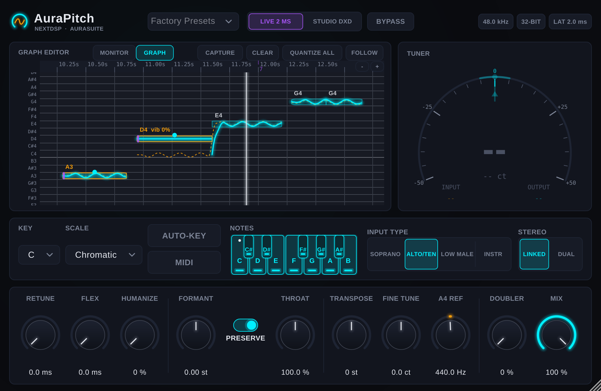
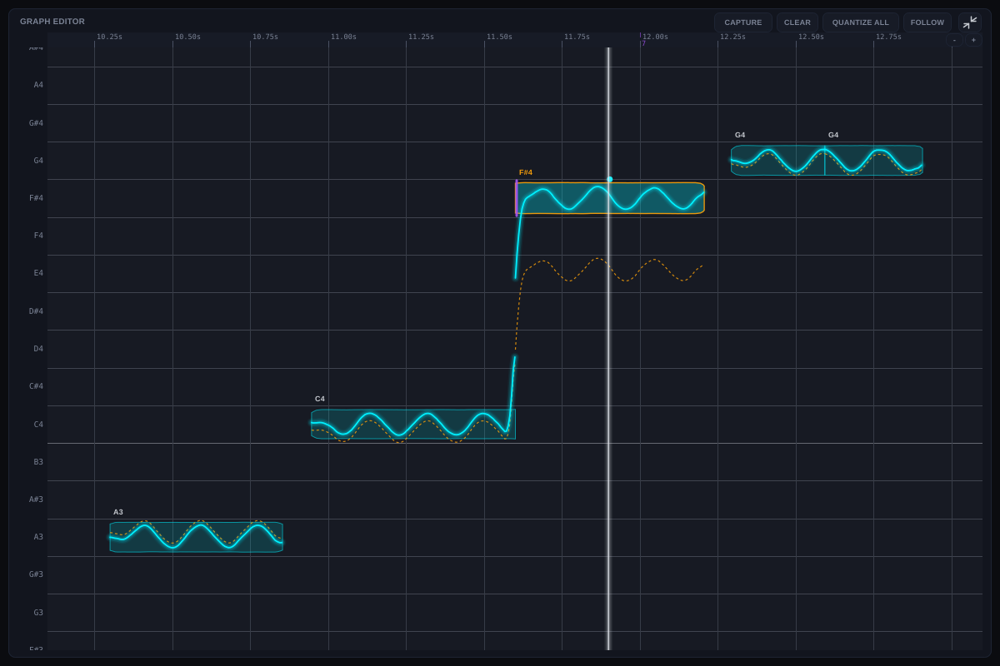
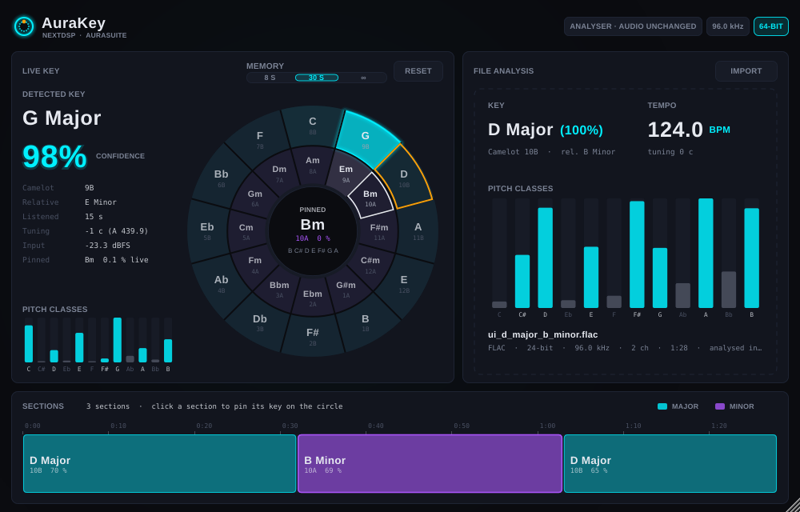

# AuraSuite — NextDSP · AuraPitch + AuraKey

Deux plug-ins **VST3** (ni Audio Unit, ni Standalone depuis l'étape 6), de 44,1 kHz au **DXD 352,8 / 384 kHz**,
traitement 64 bits. C++20 · JUCE 8.0.15.

- **AuraPitch** : correction de hauteur et Pitch & Formant Shifter (étapes 1 à 6, ci-dessous).
- **AuraKey** : analyseur de tonalité — flux live (clé, confiance, cercle des quintes) et import de fichiers (clé,
  tempo, accord, carte des sections majeures / mineures). Voir [plus bas](#aurakey).

## AuraPitch


- **Live** (2 ms) : une seule tête de lecture à raccords glottiques (interpolation sinc 48 points), TD-PSOLA à
  marques par corrélation pour les effets de formants.
- **Studio/DXD** (≈ 56–62 ms, constante) : même cœur à 44,1/48 kHz, filtre de formants différentiel (module seul,
  enveloppe vraie), architecture « delta » qui laisse intact tout ce qui dépasse la bande vocale (air du DXD).
- Sur voix réaliste : rejet de la voix fantôme 83–87 dB sur voix stable, transmission ±0,05 dB de 100 Hz à
  19,5 kHz, stéréo liée en phase exacte.
- Détection MPM 50–1200 Hz à coût constant quelle que soit la fréquence, voisement anti-sifflantes.
- Gammes, clavier 12 notes (Active / Bypass / Removed), Retune 0–400 ms, Humanize, Transpose ±24, Fine ±100 c,
  A4 415–466 Hz, Formant ±12, Mix aligné à l'échantillon, stéréo liée ou double mono, bypass sans clic.
- **Expressif (étape 5A)** :
  - **Flex** (Transition 0–200 ms) : glissandos et slides d'attaque passent tels quels, puis la note se verrouille ;
  - **Throat** 80–120 % : F1–F3 déplacés comme par un conduit vocal plus long ou plus court, aigus intacts ;
  - **Doubler** 0–100 % : deux voix à +9 ms / −7 c et +14 ms / +7 c (stéréo) ;
  - **AUTO-KEY** : détection de la tonalité (Temperley, bayésien) et application en un clic ;
  - **MIDI Target** : la voix va à la note MIDI jouée (la plus proche dans un accord), Pitch Bend ±2 dt.
- Ergonomie : glissé fin ÷5 (Maj ou Cmd/Ctrl), double-clic = valeur par défaut, clic sur la valeur ou clic droit =
  saisie au clavier, **FREEZE** du graphe, notes MIDI éclairées sur le clavier et la grille.


- **GRAPH EDITOR (étape 5B)**, sans audio en RAM : **CAPTURE** enregistre les notes chantées sur la timeline du DAW
  (AudioPlayHead, ≈ 50 Ko par minute de chant), segmentées automatiquement en notes (liaisons legato comprises) ;
  chaque note se déplace (demi-ton aimanté ou au cent), se quantifie (double-clic), se scinde (clic droit), perd ou
  gagne son vibrato (Cmd/Ctrl), reçoit un glissé d'attaque (poignée gauche) et son propre formant (Cmd/Ctrl + Alt).
  Au rejeu, la correction est calculée d'après la hauteur capturée, pour l'instant exact lu, sans retard du
  détecteur, en Live comme en Studio. Les notes sont sauvegardées avec la session.



- **Vue agrandie (étape 6)** : le bouton à double flèche de l'en-tête ouvre le GRAPH EDITOR dans une grande fenêtre
  dédiée (1200 × 800, redimensionnable, plein écran de l'OS), avec sa vue, sa sélection et son zoom. Le bouton
  réduire, la fermeture de la fenêtre ou Échap le ramènent dans le plug-in ; la fenêtre rouvre à sa dernière position.



## AuraKey

- **Live** : inséré sur une piste ou le bus master, AuraKey laisse passer l'audio **sans aucune modification**
  (sortie identique à l'entrée au bit près) et en tire la tonalité : chromagramme polyphonique (pics spectraux,
  accord du morceau estimé) puis l'**Auto-Key de l'étape 5A** (profils de Temperley, a posteriori bayésien sur les
  24 clés). Affichage « B Minor (97%) », code Camelot, relative, accord, classes de hauteur. Mémoire 8 s (suit les
  modulations), 30 s ou ∞ (tout le morceau), RESET. Aucune allocation, aucun verrou sur le thread audio.
- **Cercle des quintes** : intensité = probabilité de chaque clé ; clé live lumineuse, clé du fichier en ambre ;
  survol et clic pour épingler une clé (notes de la gamme, probabilité live).
- **Import** : glisser un fichier sur le plug-in (ou IMPORT) — WAV, AIFF, FLAC, MP3 (et Ogg), 16/24/32 bits entiers ou
  flottants, jusqu'au DXD 384 kHz. Décodage par blocs sur un fil de travail (le thread audio n'est jamais bloqué),
  puis clé, **tempo** (BPM), accord et **carte des sections** (Viterbi sur une fenêtre glissante : modulations
  détectées). L'analyse est sauvegardée avec le projet.



## Compiler

```bash
cmake -B build -DCMAKE_BUILD_TYPE=Release        # JUCE 8.0.15 est téléchargé depuis GitHub
cmake --build build --config Release
ctest --test-dir build -C Release --output-on-failure
```

| Système | Pré-requis | Produits |
|---|---|---|
| macOS 11+ (Apple Silicon et Intel) | Xcode 15 + CMake ≥ 3.22. Binaire universel par défaut | `build/AuraPitch_artefacts/Release/VST3/AuraPitch.vst3`, `build/AuraKey_artefacts/Release/VST3/AuraKey.vst3` |
| Windows 10+ | Visual Studio 2022 (C++), CMake ≥ 3.22 | idem (`.vst3`) |
| Linux | `libasound2-dev libx11-dev libxrandr-dev libxinerama-dev libxcursor-dev libxext-dev libxcomposite-dev libfreetype-dev libfontconfig1-dev` | idem (`.vst3`) |

Options : `-DJUCE_DIR=/chemin/JUCE` (JUCE local), `-DAURAPITCH_COPY_PLUGIN=ON` (copie des deux `.vst3` dans
`~/Library/Audio/Plug-Ins/VST3` après compilation), `-DAURAPITCH_BUILD_PLUGIN=OFF` (noyaux DSP et bancs seuls, sans
JUCE), `-DAURASUITE_BUILD_AURAKEY=OFF` (sans AuraKey), `-DAURAKEY_MP3_DECODER=OFF` (sans le décodeur MP3 logiciel de
JUCE ; sous macOS, Core Audio lit encore les MP3). La cible `AuraPitchTests` construit les sept bancs.

Depuis l'étape 6, plus aucun `.component` ni `.app` n'est produit. Une session Logic qui utilisait l'AU d'AuraPitch
doit passer par un hôte VST3.

**macOS, première ouverture** : les plug-ins ne sont pas signés par un compte développeur Apple (signature ad hoc).
Si le DAW les refuse : `xattr -dr com.apple.quarantine ~/Library/Audio/Plug-Ins/VST3/AuraPitch.vst3` (idem pour
`AuraKey.vst3`).

**CI** : `.github/workflows/build.yml` compile macOS (universel), Windows x64 et Linux, lance `ctest` et publie les
archives VST3 ; une étiquette `v*` crée une release GitHub. Le quota de minutes macOS du compte est épuisé : la
validation de l'étape 6 a été faite localement (Linux, sanitizers).

## Bancs d'essai

| Cible | Contenu | Résultat |
|---|---|---|
| `aurapitch_dsp_test` | détecteur, gamme, courbe de correction, FIFO | 247 / 247 |
| `aurapitch_engine_test` | FFT, enveloppe, PSOLA, raccords, Studio/DXD, moteur, temps réel | 134 / 134 |
| `aurapitch_realvoice_test` | voix réaliste : interpolation, voix fantôme, voile, flow rapide, stéréo | 32 / 32 |
| `aurapitch_step5a_test` | Auto-Key, MIDI Target, Flex, Throat, Doubler, transparence au bit près, CPU, temps réel | 209 / 209 |
| `aurapitch_step5b_test` | GRAPH EDITOR : capture et segmentation, édition et rejeu, transparence, scission et état, temps réel avec éditions concurrentes, processeur (AudioPlayHead, état), interface | 66 / 66 (48 sans JUCE) |
| `aurapitch_plugin_test` | processeur JUCE : paramètres, presets, latence, 32/64 bits, double mono, bypass, état, éditeur, MIDI de l'hôte, ergonomie 5A | 73 / 73 |

Architecture détaillée et mesures : [ARCHITECTURE.md](ARCHITECTURE.md).

## Licences

JUCE 8 : AGPLv3 ou licence commerciale JUCE. Distribuer un binaire d'AuraPitch impose l'une des deux.
